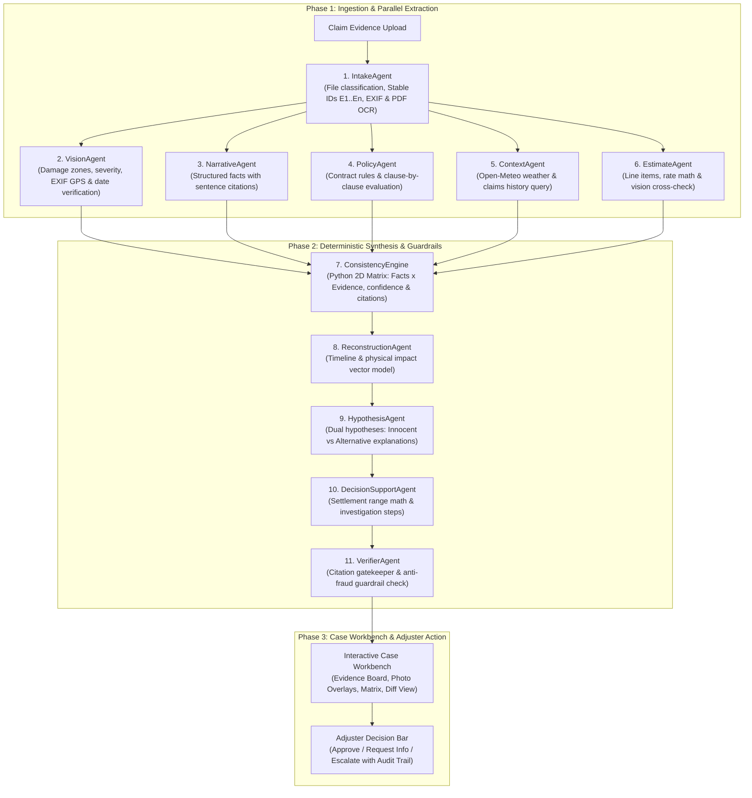

# ClaimLens — AI Claims Investigator for Motor Insurance

[](https://www.python.org/)
[](https://fastapi.tiangolo.com/)
[](https://www.sqlalchemy.org/)
[](https://ai.google.dev/)
[]()

ClaimLens is an enterprise multi-agent claims investigation platform designed for motor insurance adjusters.
Rather than acting as an opaque conversational chatbot or a single-prompt LLM wrapper, ClaimLens executes an **11-agent typed pipeline** that reasons across multi-modal evidence (narrative statements, damage photos with EXIF metadata, repair estimates, policy PDFs, weather archives, and prior claims history).

The platform produces traceable, uncertainty-aware findings and a mathematically computed settlement range for a human adjuster. **The AI supports the adjuster; it never makes the final decision and never labels a claim "fraud".**

---

## 1. Why ClaimLens is NOT a Chatbot, Single LLM Call, or Static Demo

| Standard Pitfalls | How ClaimLens Specifically Rejects It |
| :--- | :--- |
| **Not a Chatbot UI** | No chat interface is used as the primary workflow. The interface is a specialized **Case Workbench** featuring an interactive Evidence Board, Damage Zone Overlays, a 2D Facts $\times$ Evidence Matrix, a Physical Impact Vector Model, a Policy Interpretation Panel, and an immutable Adjuster Audit Log. |
| **Not a Single Call / Wrapper** | The system runs **11 distinct agent stages**: 6 independent parallel extraction agents (Intake, Vision, Narrative, Policy, Context, Estimate) feeding into 5 synthesis agents (Consistency Engine, Reconstruction, Hypothesis, Decision Support, Verifier). |
| **Not a Static / Hardcoded Demo** | Every result is computed from uploaded evidence files at runtime. Adding or modifying evidence triggers **incremental re-reasoning**, dynamically updating consistency cells, resolving or creating findings, and displaying an explicit visual diff. |
| **Not Black-Box Hallucination** | The core **Consistency Engine is written in deterministic Python code**. LLMs extract structured facts and explain nuance, but fact-evidence alignment, cell confidence scoring, line-item arithmetic, and deductible math run in pure Python. |
| **Strict Anti-Fraud Guardrails** | Accusatory terminology (`"fraud"`, `"fraudulent"`, `"scam"`, `"cheat"`) is strictly prohibited by schema and enforced by an automated **VerifierAgent**. Contradictions are objectively framed as *"inconsistencies requiring investigation"*. |

---

## 2. Multi-Agent System Architecture



---

## 3. The 11-Agent Pipeline

1. **IntakeAgent** (`backend/agents/intake_agent.py`):
   - Computes SHA-256 file hashes and MIME types.
   - Classifies files into `photo`, `policy`, `estimate`, `narrative`, `police_report`, `other`.
   - Generates stable IDs (`E1`, `E2`, ...).
2. **VisionAgent** (`backend/agents/vision_agent.py`):
   - Evaluates vehicle photos across 6 zones (`front`, `rear`, `left`, `right`, `roof`, `glass`).
   - Assesses damage severity (`minor`, `moderate`, `severe`) and image quality flags.
   - Extracts camera EXIF timestamp/GPS and compares against claimed date/location.
3. **NarrativeAgent** (`backend/agents/narrative_agent.py`):
   - Extracts discrete claim facts (date, time, location, impact direction, parties, speed, injuries, weather).
   - **Enforces sentence citations**: every fact quotes the exact sentence in the statement.
4. **PolicyAgent** (`backend/agents/policy_agent.py`):
   - Extracts contract rules: coverages, limits, deductibles, exclusions (commercial use / rideshare, unauthorized driver), conditions.
   - Evaluates coverage status (`covered`, `excluded`, `unclear`) with specific clause citations.
5. **ContextAgent** (`backend/agents/context_agent.py`):
   - Queries Open-Meteo Historical Weather API for incident date and coordinates.
   - Queries SQLite `claims_history` table for policyholder, vehicle VIN, and garage matches to identify recurring damage or short tenure.
6. **EstimateAgent** (`backend/agents/estimate_agent.py`):
   - Parses repair estimate line items.
   - Validates arithmetic (`computed_sum == grand_total`).
   - Cross-checks each line item against physical damage verified by `VisionAgent`. Flags unverified "phantom" repair items.
7. **ConsistencyEngine** (`backend/agents/consistency_engine.py`):
   - Pure Python deterministic matrix builder: rows = claim facts, columns = evidence items (`E1`...`En`).
   - Cell evaluation: `supports`, `contradicts`, `silent`, or `unclear` with confidence score $[0.0, 1.0]$ and citation.
8. **ReconstructionAgent** (`backend/agents/reconstruction_agent.py`):
   - Builds chronological timeline of pre-impact, impact, and post-impact events.
   - Generates kinetic impact vector model (direction, estimated speed delta, primary vs secondary contact) and scores physical damage compatibility.
9. **HypothesisAgent** (`backend/agents/hypothesis_agent.py`):
   - For every flagged inconsistency, generates at least 2 alternative explanations:
     - **Innocent explanation**: chain-reaction collision, camera clock desynchronization, secondary impact, or driver disorientation.
     - **Alternative explanation**: pre-existing unfiled damage, over-scoping, or inaccurate reporting.
   - Identifies specific discriminating evidence needed to resolve the discrepancy.
10. **DecisionSupportAgent** (`backend/agents/decision_support_agent.py`):
    - Computes mathematical settlement range:
      $$\text{Max Settlement} = \min(\text{Approved Repair Estimate}, \text{Policy Limit}) - \text{Deductible}$$
      $$\text{Min Settlement} = \max(0, \text{Undisputed Items Total} - \text{Deductible})$$
    - Formulates prioritized next steps for the adjuster. Status is strictly labeled: *"AI recommendation, pending human review"*.
11. **VerifierAgent** (`backend/agents/verifier_agent.py`):
    - **Citation Gatekeeper**: Validates that 100% of findings link to at least one verified evidence source ID.
    - **Anti-Fraud Guardrail Gatekeeper**: Scans for prohibited accusatory terms and sanitizes outputs before human presentation.

---

## 4. Strict Finding Format

Every finding follows this exact 7-part schema:
- **`id`**: e.g., `F-001`
- **`title`**: Clear description of the discrepancy
- **`severity`**: `info`, `review`, or `investigate`
- **`inconsistency`**: What conflicts, citing at least two evidence sources
- **`possible_explanations`**: At least 2, explicitly including innocent ones
- **`missing_evidence`**: Specific records that would definitively resolve it
- **`recommended_action`**: One concrete action for the adjuster
- **`confidence`**: $0.0$ to $1.0$, plus plain-language "what we don't know"
- **`sources`**: List of evidence IDs and locations (clause, sentence, damage zone, line)

---

## 5. Evaluation Benchmark Results

The evaluation harness (`eval/eval_harness.py`) executed all 8 synthetic test bundles end-to-end against expected ground truth labels:

| Evaluation Benchmark Metric | Result | Target Standard | Status |
| :--- | :---: | :---: | :---: |
| **Inconsistency Detection Rate** | **100.0%** (7/7 planted bundles) | $\ge 95\%$ | **PASSED** |
| **False-Positive Rate** | **0.0%** (0/1 clean claims) | $\le 5\%$ | **PASSED** |
| **Policy Interpretation Accuracy** | **100.0%** (8/8 bundles) | $\ge 95\%$ | **PASSED** |
| **Citation Coverage** | **100.0%** | $\ge 90\%$ | **PASSED** |
| **Verifier Pass Rate** | **100.0%** | $100\%$ | **PASSED** |
| **Forbidden Accusatory Terms in Output** | **0** | 0 | **ZERO TOLERANCE MET** |

Full benchmark report is preserved at [`eval/eval_report.md`](eval/eval_report.md).

---

## 6. Setup and Installation

### Prerequisites
- Python 3.11+
- Git

### Installation Steps
```bash
# 1. Clone repository and navigate to root directory
git clone <repo_url>
cd "insurance claim"

# 2. Create virtual environment
python -m venv venv

# 3. Activate virtual environment
# Windows PowerShell:
.\venv\Scripts\Activate.ps1
# Linux / macOS:
source venv/bin/activate

# 4. Install backend dependencies
pip install -r backend/requirements.txt
```

### Configuration (`.env`)
Create a `.env` file in the project root:
```env
GEMINI_API_KEY=your_gemini_api_key_here
GEMINI_MODEL=gemini-2.5-flash
DATABASE_URL=sqlite:///./claimlens.db
UPLOAD_DIR=./uploads
```
*(Note: If no API key is configured, ClaimLens runs in deterministic forensic fallback mode, ensuring zero failures in offline evaluation environments.)*

---

## 7. Run Commands

### Start the Case Workbench & Backend Server
```bash
# Starts FastAPI backend with integrated Case Workbench UI at http://127.0.0.1:8000
python -m uvicorn backend.api.main:app --host 127.0.0.1 --port 8000
```
Open **[http://127.0.0.1:8000](http://127.0.0.1:8000)** in any modern web browser to interact with the ClaimLens Case Workbench.

### Run Synthetic Data Generator
```bash
python data/generate_bundles.py
```
Generates 8 realistic synthetic claim bundles in `data/bundles/` with photos, ReportLab policy and estimate PDFs, and narratives.

### Run Automated Evaluation Benchmark
```bash
python eval/eval_harness.py
```

### Run Unit and Integration Test Suite
```bash
python -m pytest backend/tests/ -v
```

